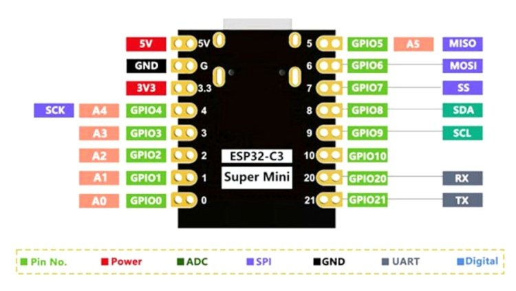
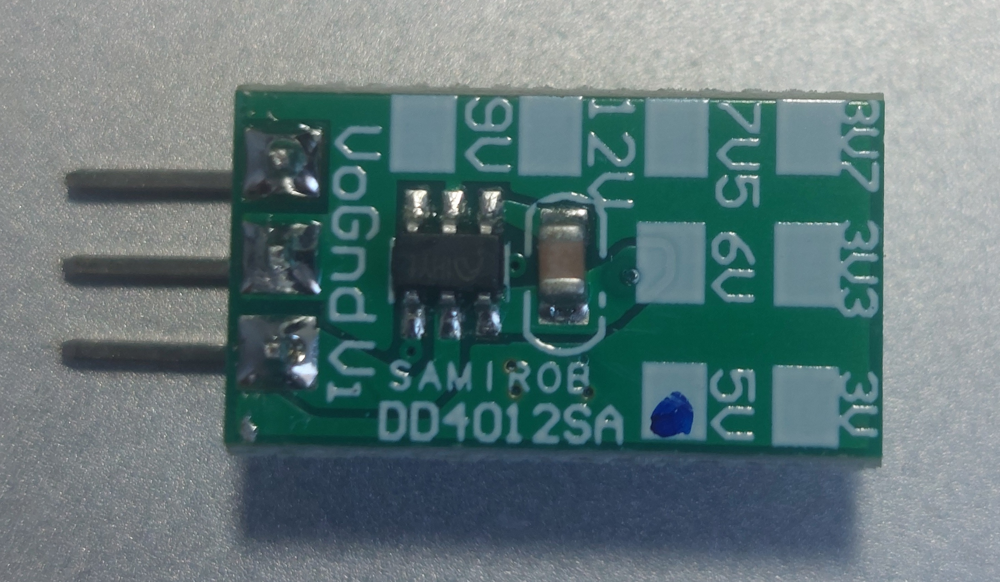
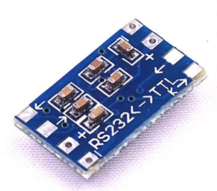
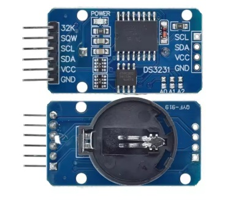

# ESP32-C3 Supermini Wifi Bridge

A solution to bridge serial data to http web-pages.

## Features

- [x] User configurable serial port (Baud rate, Data bits, Stop bits, Parity)
- [x] User configurable Http host server (mDns name and password)
- [x] Serial data accessible in Web Viewport
- [x] Wired RTC clock with backup battery
- [x] Button Press (Long press: Recovery Mode, Short press: Configuration)
- [x] Automatic hardware change detection

## Future Expansion

- [ ] Adding UART expansion using SC16IS750 module

## Wiring

All pins have been allocated avoiding collision with future hardware expansion as much as possible.
I2C SDA & SCL have been allocated to preserve SPI interface (which is sharing terminology SDA & SCL, by the way).

|  ESP32-C3 | GPIO # | Function |
|---------------|--------------------|---------|
| VIN           | 5V (Pin 1)  | Board VCC |
| GND           | GND (Pin 2) | Common ground |
| VCC           | 3.3V (Pin 3) | Components VCC (RTC, UART) |
| SCL           | GPIO1 | I2C SCL |
| SDA           | GPIO10 | I2C SDA |
| BOOT          | GPIO10 | momentary pushbutton |
| UART1 RX      | GPIO6 | Serial port RX in |
| UART1 TX      | GPIO7 | Serial port TX out |
| DS3231 RTC    | Address 0x68 | I2C RTC |

## Components

Main board voltage is 5-12V DC downward converted to 5V using buck step-down module DD4012SA.

Every other VCC is 3.3V sourced from the ESP32-C3 itself: the ttl level shift converter, all devices connected to I2C (pin 3).

The TTL-to-RS232 logic level converter is a SP3232 'brush wire' module.

The realtime clock with backup cell battery is a DS3231.

A hardware mod has been applied to:
- disable CR2032 cell battery load circuit  ([Arduino forum](https://forum.arduino.cc/t/ds3231-rtc-module-still-ships-with-charging-circuit/636626))
- remove 'power' led

## Installation

The IDE (PlatformIO) has been configured for board make: esp32-c3-devkitm-1 with framework: arduino.

The DS3231 Real Time Clock driver is adafruit/RTClib.

## Author

Various sources from the internet contributed partially or complete to this end product.

For questions, contributions, or bug reports, please visit the Issues page.